# Практическое задание 9. Git

## Оценка 3

### Шаги 1–2. Текущая ветка и журнал

```bash
git status
git log
```

<!-- Скриншот: вывод git status и git log -->


### Шаги 3–6. Создание sort.c и добавление в stage
<!-- Скриншот: оба вывода git status - до add и после -->


До `git add` файл находится в `Untracked files`: Git его ещё не отслеживает. После `add` он попадает в `Changes to be committed` как `new file`.

### Шаги 7–8. Коммит

<!-- Скриншот: коммит и git status -->


### Шаги 9–12. Изменение файла

В начало `sort.c` добавлен комментарий.


<!-- Скриншот: оба вывода git status -->


### Шаги 13–15. Ещё одно изменение и коммит

убрал комментарий, после чего сразу сделан коммит без `git add`.


<!-- Скриншот: git status и git log --oneline -->
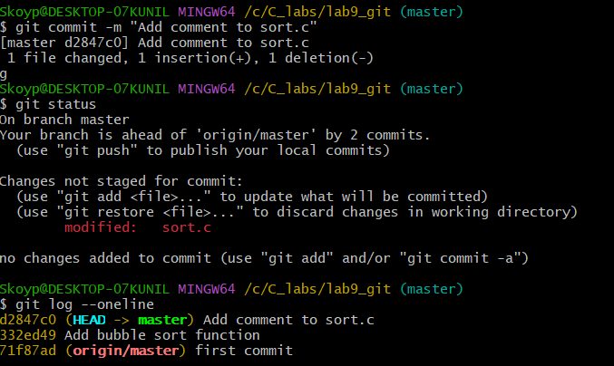

В коммит попал комментарий, потому что он был в stage. `git commit` сохраняет содержимое stage, а не текущее состояние файла.

### Шаги 16–17. Коммит последнего изменения и push


<!-- Скриншот: вывод git push -->
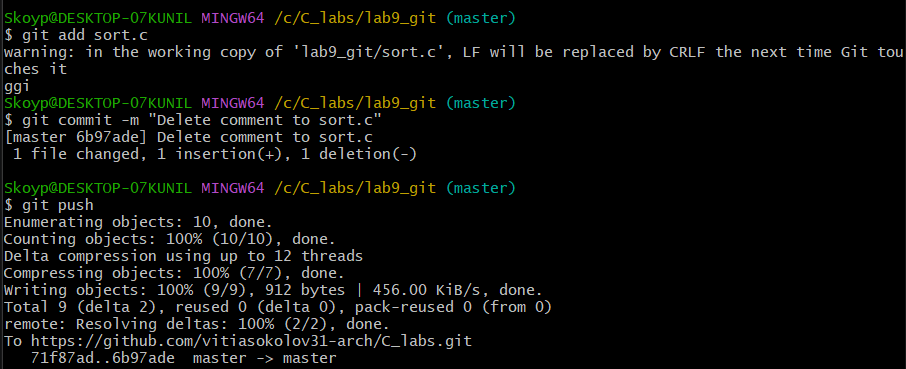

---

## Оценка 3: ветки

### Шаги 1–5. Создание ветки mybranch


<!-- Скриншот: git branch и git status на mybranch -->
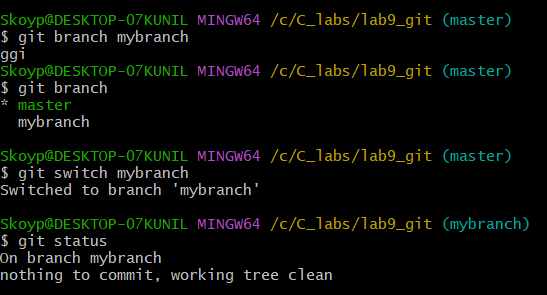

После переключения `git status` пишет `On branch mybranch` вместо `On branch master`.

### Шаги 6–8. Коммит file1.txt в mybranch
```bash
echo "Виктор" > file1.txt
git add file1.txt
git commit -m "Add file1.txt"
git log --oneline --graph
```

### Шаги 9–12. Коммит file2.txt в master

<!-- Скриншот: последний git log --oneline --graph --all с развилкой -->
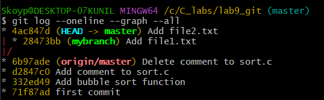

В `master` нет коммита `Add file1.txt`. На графе видна развилка: у каждой ветки свой коммит.

### Шаги 13–15. Сравнение веток


<!-- Скриншот: ls и git diff -->


`file2.txt` пропал, потому что он есть только в `master`. При переключении ветки Git подставляет в папку файлы этой ветки.

### Шаги 16–17. Push веток на GitHub

<!-- Скриншот: страница репозитория на GitHub со списком веток master и mybranch -->


---

## Оценка 4

### Шаги 1–4. Добавление main в sort.c

```bash
git switch mybranch
nano sort.c
```

```c
#include <stdio.h>

/* Сортировка пузырьком */
/* a - массив, n - количество элементов */
void bubble_sort(int *a, int n)
{
    for (int i = 0; i < n - 1; i++)
        for (int j = 0; j < n - 1 - i; j++)
            if (a[j] > a[j + 1]) {
                int t = a[j];
                a[j] = a[j + 1];
                a[j + 1] = t;
            }
}

int main(void)
{
    int a[] = {4, 2, 0, 7, 1};
    int n = sizeof(a) / sizeof(a[0]);

    bubble_sort(a, n);

    for (int i = 0; i < n; i++)
        printf("%d ", a[i]);
    printf("\n");

    return 0;
}
```

```bash
git diff
git diff --staged
```

<!-- Скриншот: git diff (видны строки с +) и пустой git diff --staged -->
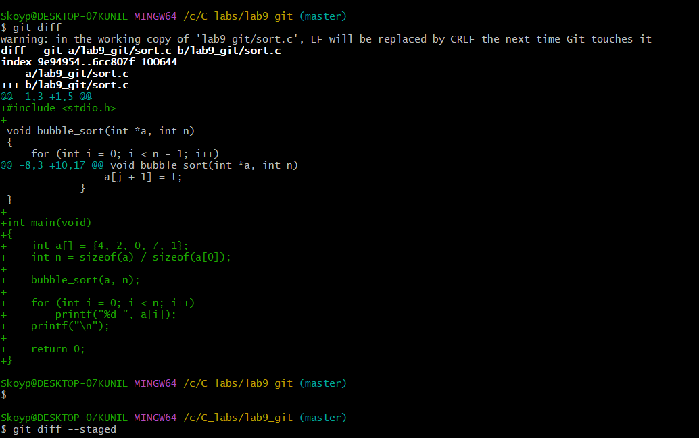

### Шаги 5–7. После add

```bash
git add sort.c
git diff
git diff --staged
```

<!-- Скриншот: пустой git diff и git diff --staged -->
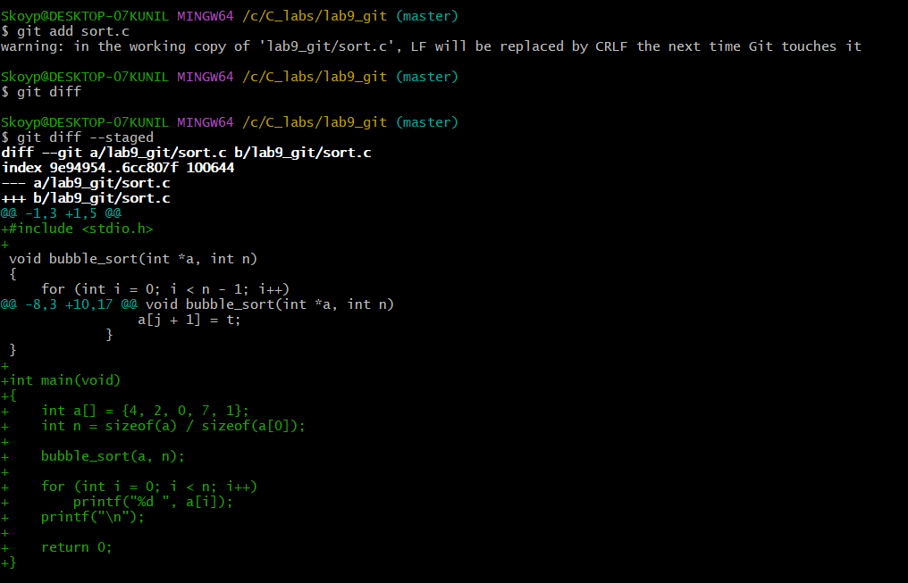

### Шаги 8–11. Изменение после add

В массиве удалено последнее число: `{4, 2, 0, 7, 1}` → `{4, 2, 0, 7}`.

```bash
nano sort.c
git diff
git diff --staged
```

<!-- Скриншот: git diff и git diff --staged -->
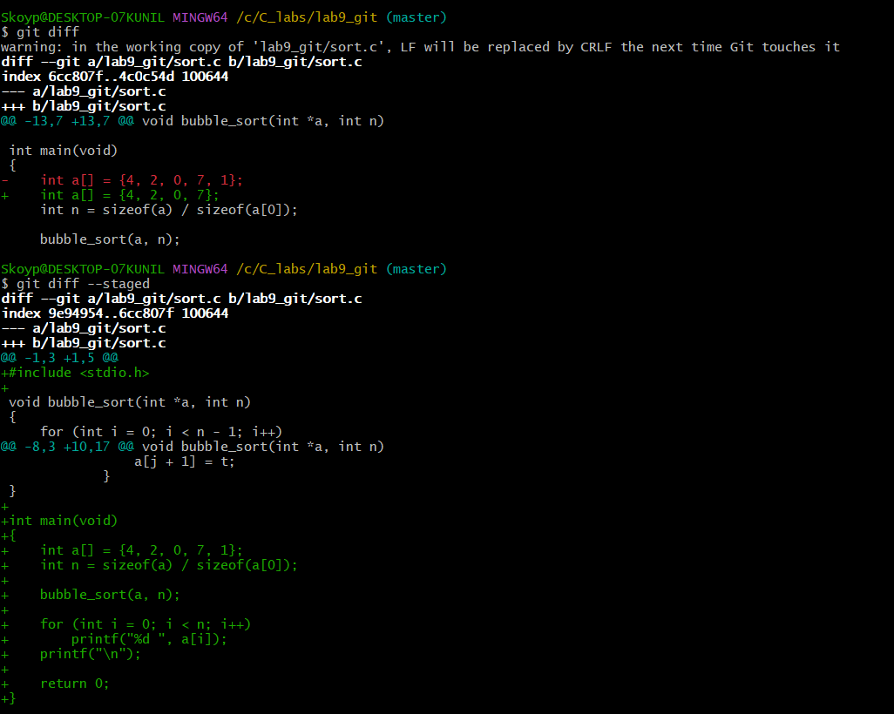

Сейчас у файла три версии: в последнем коммите (без `main`), в stage (`main` и пять чисел) и в рабочей папке (`main` и четыре числа). `git diff` сравнивает рабочую папку со stage и показывает только удалённое число. `git diff --staged` сравнивает stage с последним коммитом и показывает добавление `main`.

### Шаги 12–16. restore --staged и коммит

```bash
git status
git restore --staged sort.c
git status
git add sort.c
git commit -m "Add main to sort.c"
git log --oneline
```

<!-- Скриншот: оба git status (sort.c дважды, затем один раз) и git log -->
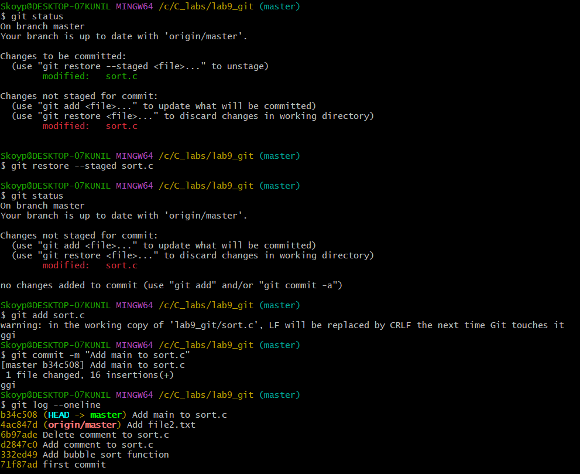

`sort.c` дважды встречается в `git status`: один раз в stage, второй раз как изменение после `add`. `git restore --staged` убирает изменения из stage, но сам файл не трогает.

### Шаги 17–22. Отмена изменения через restore

В `main` добавлена строка `printf("hello git\n");`.

```bash
nano sort.c
cat sort.c
git status
git restore sort.c
cat sort.c
git status
```

<!-- Скриншот: cat и git status до и после git restore -->
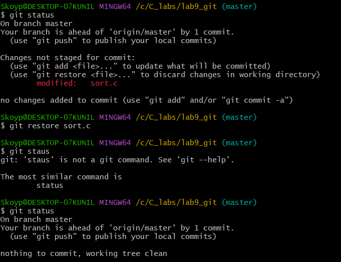

`git restore` возвращает файл к версии из последнего коммита: строка с `printf` пропала, несохранённые изменения потеряны.

### Шаг 23

```bash
git push
```

---

## Оценка 4: ветки и ff-merge

### Шаги 1–9. greeting.txt и ветка feature/uppercase

```bash
git switch master
touch greeting.txt
git add greeting.txt
git commit -m "Add file greeting.txt"
echo "hello" > greeting.txt
git add greeting.txt
git commit -m "Add content to greeting.txt"

git branch feature/uppercase
git switch feature/uppercase
git status
echo "HELLO" > greeting.txt
git add greeting.txt
git commit -m "Make greeting uppercase"
git branch
git log --oneline --graph --all
```

<!-- Скриншот: git branch и git log --oneline --graph --all -->
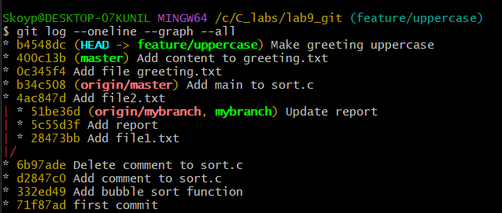

### Шаги 10–14. Fast-forward merge

```bash
git switch master
cat greeting.txt
git diff master feature/uppercase
git merge feature/uppercase
cat greeting.txt
```

<!-- Скриншот: cat, diff, merge со словом Fast-forward и снова cat -->
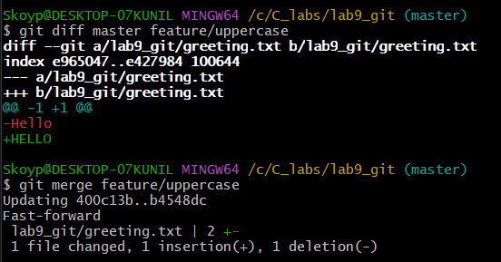

Git выполнил **fast-forward**: в `master` не было новых коммитов после создания `feature/uppercase`, поэтому Git просто передвинул `master` вперёд, без отдельного коммита слияния.

### Шаги 15–17. Слияние mybranch в master

```bash
git branch -d feature/uppercase
git merge mybranch
git log --oneline --graph --all
```

<!-- Скриншот: git log --oneline --graph --all после слияния -->
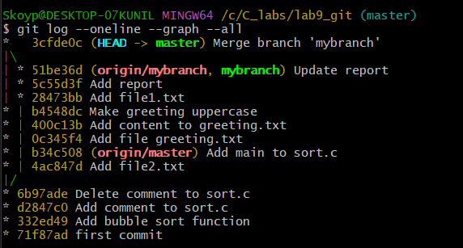

Здесь fast-forward невозможен, потому что у обеих веток есть свои коммиты. Git создал коммит слияния с двумя родителями, на графе две линии сходятся в нём.

### Шаги 18–19

```bash
git add README.md img
git commit -m "Update report"
git push
```

---

## Оценка 5: конфликт в file.txt

### Шаги 1–6. Разные изменения одного файла в двух ветках

```bash
git switch -c branch1
echo "This is a relevant fact" > file.txt
git add file.txt
git commit -m "Add relevant fact"

git switch master
echo "This is an indispensable truth!" > file.txt
git add file.txt
git commit -m "Add indispensable truth"
git log --oneline --graph --all
```

### Шаги 7–8. Конфликт

```bash
git merge branch1
git status
```

<!-- Скриншот: сообщение CONFLICT и git status -->
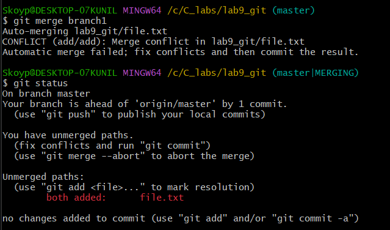

Обе ветки по-разному изменили одну строку, поэтому Git не может сам решить, что оставить.

### Шаг 9. Исправление конфликта

<!-- Скриншот: file.txt в VS Code с маркерами конфликта -->
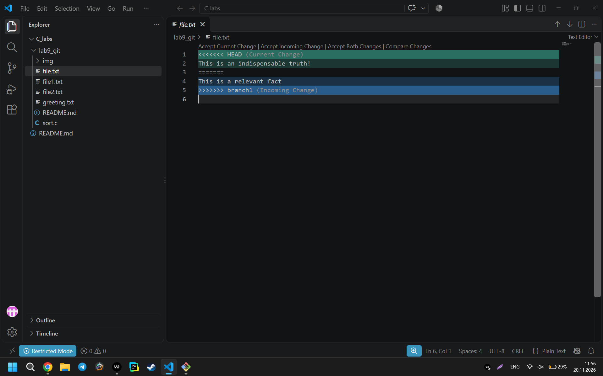

Между `<<<<<<< HEAD` и `=======` лежит версия из `master`, между `=======` и `>>>>>>> branch1` лежит версия из `branch1`. Выбрано **Accept Both Changes**, чтобы оставить обе строки.

```bash
git add file.txt
git commit -m "Merge branch1: resolve conflict in file.txt"
```

### Шаги 10–11

```bash
git log --oneline --graph
git push
```

<!-- Скриншот: git log --oneline --graph с коммитом слияния -->
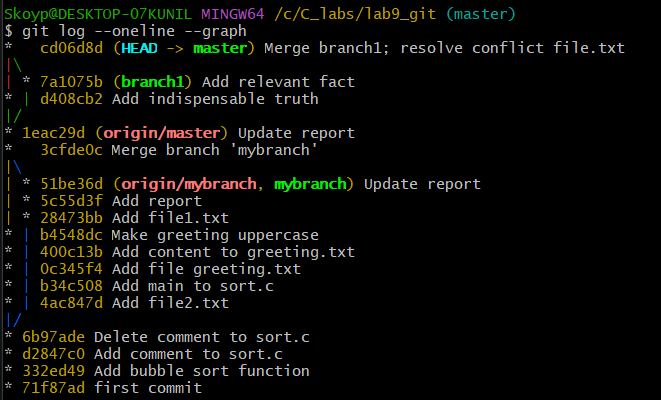

---

## Оценка 5: конфликт в mergesort.py

### Шаги 1–9. Две версии mergesort.py

```bash
git switch master
cp ~/lab9_report/base.py mergesort.py
git add mergesort.py
git commit -m "Add mergesort.py base"

git switch -c Mergesort-Impl
cp ~/lab9_report/righty.py mergesort.py
git commit -am "Implement merge sort (righty)"

git switch master
cp ~/lab9_report/lefty.py mergesort.py
git commit -am "Implement merge sort (lefty)"

git log --oneline --graph --all
git branch
```

<!-- Скриншот: git log --oneline --graph --all и git branch -->
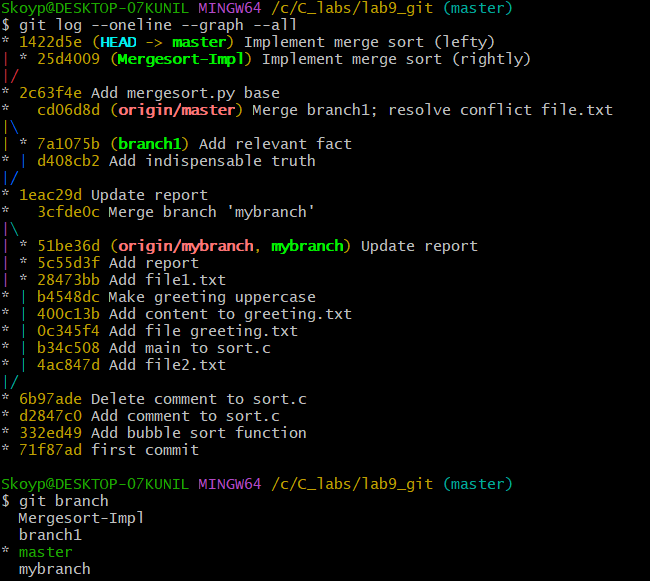

### Шаг 10. Слияние и исправление конфликтов

```bash
git merge Mergesort-Impl
```

<!-- Скриншот: mergesort.py в VS Code с конфликтами -->
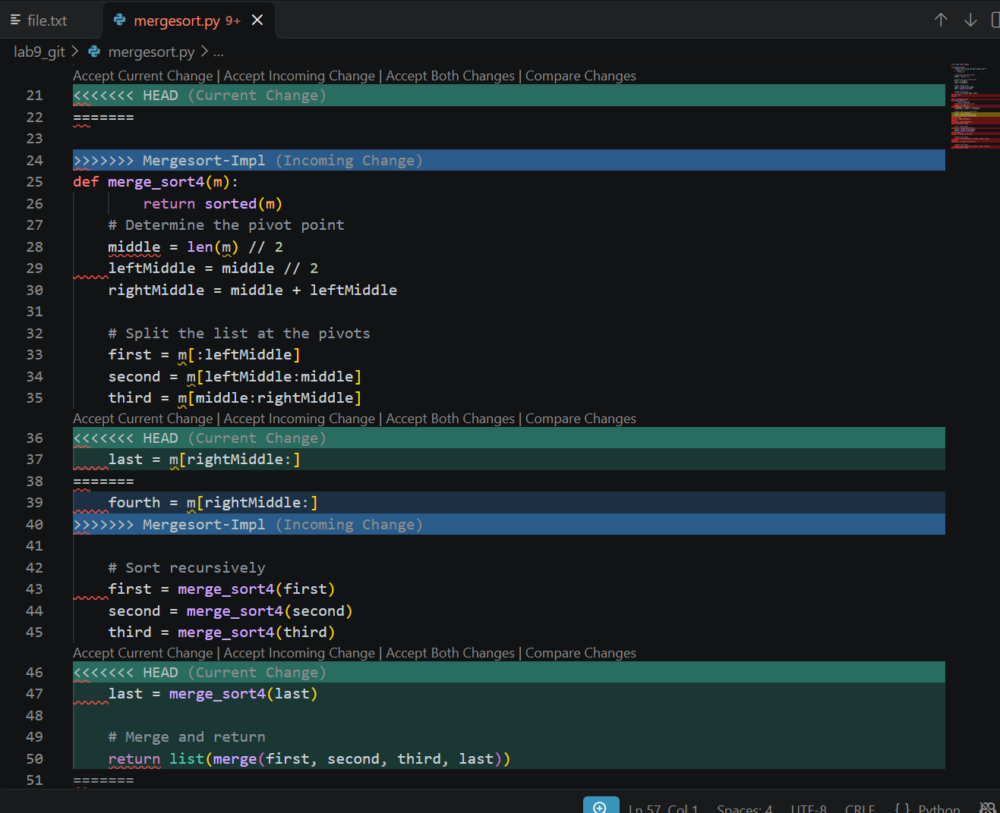

В файле четыре конфликта: разный порядок строк `left`/`right`, пустая строка между функциями и разные имена четвёртой части списка (`last` в `master`, `fourth` в `Mergesort-Impl`). Оставлен вариант из `master` и пустая строка между функциями. Имя переменной надо выбрать одинаково во всех местах, иначе получится несуществующая переменная и ошибка `NameError`.

Проверка, что код работает:

```bash
python3 -c "from mergesort import *; print(merge_sort2([5,3,8,1,9,2])); print(merge_sort4([5,3,8,1,9,2,7,4,6,0]))"
rm -rf __pycache__
git add mergesort.py
git commit -m "Merge Mergesort-Impl: resolve conflicts"
```

<!-- Скриншот: вывод python3 с отсортированными списками -->
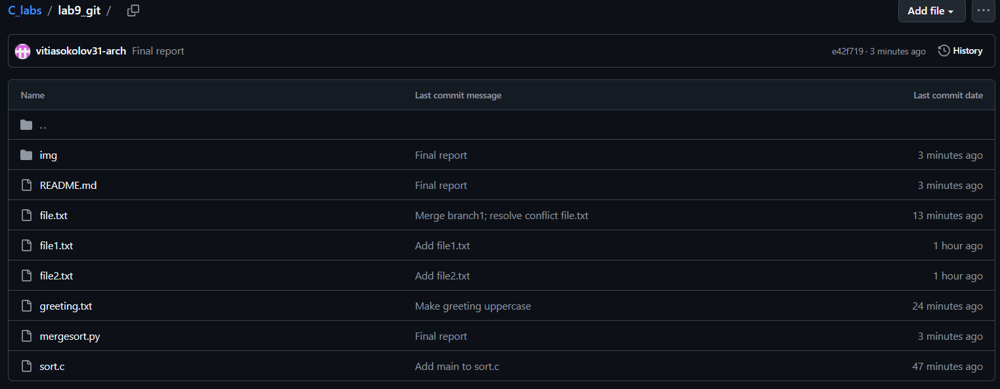

### Шаги 11–12

```bash
git log --oneline --graph
git add README.md img
git commit -m "Final report"
git push
```

<!-- Скриншот: репозиторий на GitHub после финального push -->

