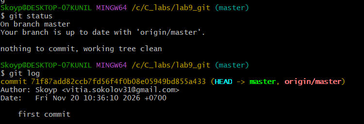
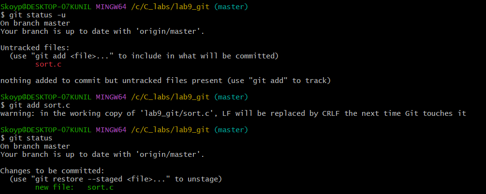
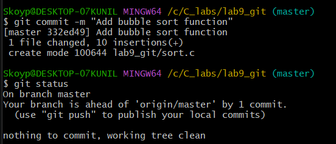
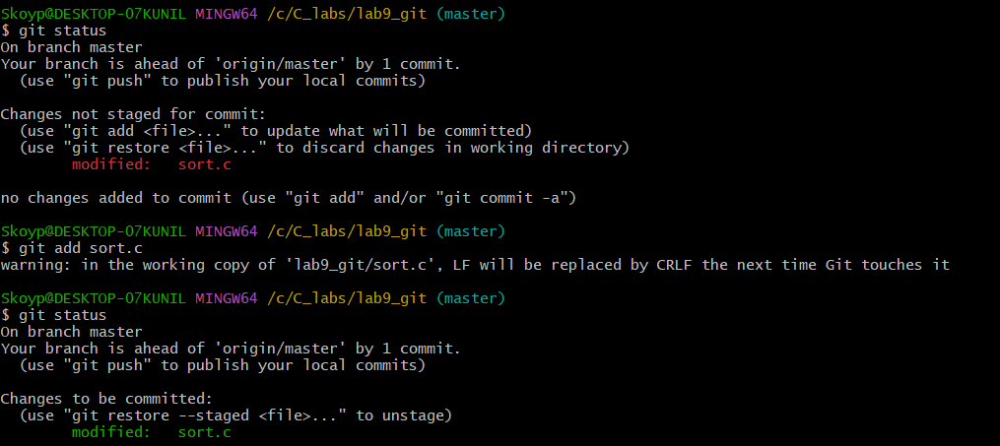
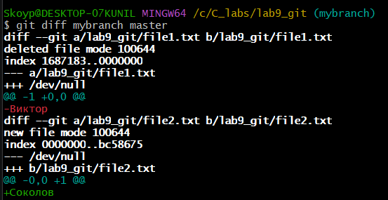
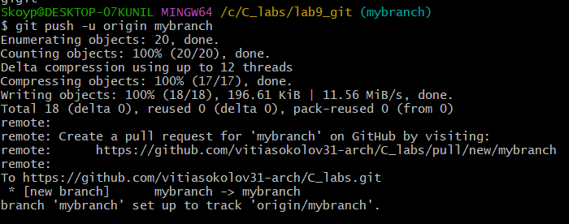

# Практическое задание 9. Git

## Оценка 3

### Шаги 1–2. Текущая ветка и журнал

```bash
git status
git log
```

<!-- Скриншот: вывод git status и git log -->


### Шаги 3–6. Создание sort.c и добавление в stage
<!-- Скриншот: оба вывода git status - до add и после -->


До `git add` файл находится в `Untracked files`: Git его ещё не отслеживает. После `add` он попадает в `Changes to be committed` как `new file`.

### Шаги 7–8. Коммит

<!-- Скриншот: коммит и git status -->


### Шаги 9–12. Изменение файла

В начало `sort.c` добавлен комментарий.


<!-- Скриншот: оба вывода git status -->


### Шаги 13–15. Ещё одно изменение и коммит

убрал комментарий, после чего сразу сделан коммит без `git add`.


<!-- Скриншот: git status и git log --oneline -->


В коммит попал комментарий, потому что он был в stage. `git commit` сохраняет содержимое stage, а не текущее состояние файла.

### Шаги 16–17. Коммит последнего изменения и push


<!-- Скриншот: вывод git push -->


---

## Оценка 3: ветки

### Шаги 1–5. Создание ветки mybranch


<!-- Скриншот: git branch и git status на mybranch -->


После переключения `git status` пишет `On branch mybranch` вместо `On branch master`.

### Шаги 6–8. Коммит file1.txt в mybranch
```bash
echo "Виктор" > file1.txt
git add file1.txt
git commit -m "Add file1.txt"
git log --oneline --graph
```

### Шаги 9–12. Коммит file2.txt в master

<!-- Скриншот: последний git log --oneline --graph --all с развилкой -->


В `master` нет коммита `Add file1.txt`. На графе видна развилка: у каждой ветки свой коммит.

### Шаги 13–15. Сравнение веток


<!-- Скриншот: ls и git diff -->


`file2.txt` пропал, потому что он есть только в `master`. При переключении ветки Git подставляет в папку файлы этой ветки.

### Шаги 16–17. Push веток на GitHub

<!-- Скриншот: страница репозитория на GitHub со списком веток master и mybranch -->


---
